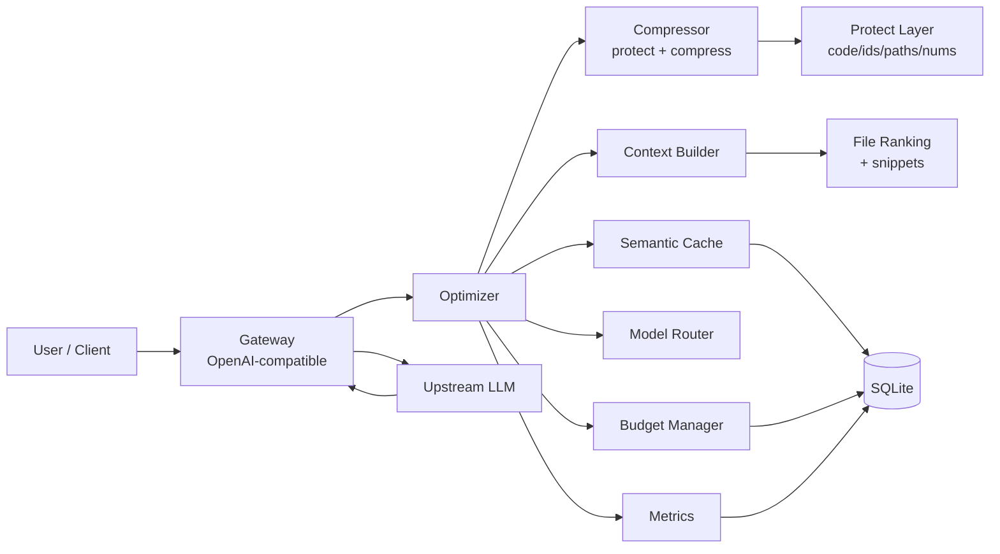

<div align="center">
  

# ☀️ SOLAR

### Token Optimization Layer for LLM Workflows

**Spend fewer tokens. Keep the answers right.**

[](https://www.python.org/)
[](LICENSE)
[](#tests)
[](https://pypi.org/project/solar-tokens/)
[](#gateway)
[](#architecture)
[](CONTRIBUTING.md)

> SOLAR sits between you and any OpenAI-compatible LLM endpoint and makes your
> tokens go further — without making the model wrong.

[Quick Start](#quick-start) · [Features](#features) · [Architecture](#architecture) · [Gateway](#gateway) · [Roadmap](#roadmap)

</div>

---

## Why SOLAR?

LLMs are expensive and slow, but most of what you send them is **waste**:

- repeated instructions across turns
- whole files when only 20 lines matter
- the same question asked twice
- a 500-token model answer to a 5-token question
- a frontier model doing a task a small model could handle

SOLAR fixes all five — and **proves it** with a built-in eval harness instead of
promising numbers.

## Features

<table>
<tr>
<td width="50%">

### 🗜️ Prompt Compression
Removes polite filler, verbose phrases and repeated sentences. Collapses
repeated log lines into `[xN] signature`.

**Hard rule:** code, commands, identifiers, paths, numbers and quoted literals
are *never* rewritten. Verified after compression; on failure the original is
returned untouched.

</td>
<td width="50%">

### 📂 Context Optimizer
Ranks project files by relevance to the query, extracts the best line window
per file, and fits everything into a token budget. Adds dependency summaries,
git diff and a compact structure tree.

No more dumping the whole repo.

</td>
</tr>
<tr>
<td width="50%">

### 🧠 Semantic Cache
Exact hash first, then cosine similarity on a **local** hashing embedder
(no API key, no service). Two modes:

- `safe` — reuse only when the context fingerprint still matches
- `semantic` — similarity only

TTL + LRU eviction, scoped per project/model.

</td>
<td width="50%">

### 🔀 Smart Model Router
Detects task kind (simple / docs / code / debug / architecture) and picks the
cheapest model that meets the required quality tier and fits the context window.
User rules (`when` regex → model) take precedence.

Disabled by default — enable when you have measurements.

</td>
</tr>
<tr>
<td width="50%">

### 💰 Token Budget Manager
Per request / session / project / day limits. Warnings at a configurable
percentage. Forecasting and remaining-token reporting.

</td>
<td width="50%">

### 📊 Metrics & Eval
Per project / model / day aggregates: tokens, savings, cost, cache hit rate.
Built-in eval harness (dry-run + live) with pass/fail checks and regression
detection.

</td>
</tr>
</table>

## Quick Start

```bash
# install
pip install -e .
pip install -e ".[exact]"   # optional: exact tiktoken counting

# create config
solar init

# compress a prompt
echo "Please could you kindly refactor load_config() ..." | solar compress --verbose

# build a context bundle
solar context "refactor load_config" --root . --json

# run the gateway
solar serve
# → point your client at http://127.0.0.1:8420/v1
```

## Architecture



### Pipeline per request

```
user prompt
  → count original tokens
  → build context bundle (ranked files, budgeted)
  → compress messages (prose only, protected spans verified)
  → cache lookup (exact → semantic)
  → route model (cheapest that fits quality + context)
  → budget check
  → forward to upstream
  → record metrics + store cache entry
```

### Module map

```
solar/
├── config.py      configuration (dataclasses, env + json)
├── models.py      Message, Usage, OptimizationReport, OptimizedRequest
├── tokens.py      token estimation (tiktoken optional, heuristic fallback)
├── protect.py     protected-span splitter + integrity check
├── compress.py    prose / log / response compression
├── context.py     project context extraction
├── storage.py     SQLite (requests, cache, sessions, kv)
├── cache.py       semantic cache + hashing embedder
├── budget.py      budget manager
├── router.py      model router
├── metrics.py     aggregation + formatting
├── optimizer.py   orchestrates the pipeline
├── gateway.py     OpenAI-compatible HTTP proxy (streaming)
├── cli.py         command line
└── evalharness.py evaluation runner
```

## Gateway

Drop-in replacement for the OpenAI API:

```bash
solar serve                     # http://127.0.0.1:8420
export OPENAI_BASE_URL=http://127.0.0.1:8420/v1
# use any OpenAI client unchanged
```

Endpoints:

| Method | Path | Purpose |
|---|---|---|
| `GET` | `/health` | liveness |
| `GET` | `/v1/models` | configured models |
| `POST` | `/v1/chat/completions` | chat (streaming supported) |
| `GET` | `/solar/stats` | usage summary |
| `GET` | `/solar/requests` | recent requests |
| `GET/POST` | `/solar/budget` | budget status / check |
| `GET` | `/solar/cache` | cache entries |
| `POST` | `/solar/cache/clear` | clear cache |
| `POST` | `/solar/compress` | dry-run compress text |
| `POST` | `/solar/context` | build context bundle |

Response headers: `X-Solar-Saved-Tokens`, `X-Solar-Savings-Pct`,
`X-Solar-Cache`, `X-Solar-Model`.

## Configuration

`solar.json` (created by `solar init`):

```json
{
  "project": "default",
  "model": "gpt-4o-mini",
  "budget": { "max_tokens_per_request": 0, "max_tokens_per_session": 0,
              "max_tokens_per_project": 0, "max_tokens_per_day": 0, "warn_at_pct": 80 },
  "cache": { "enabled": true, "similarity_threshold": 0.92,
             "ttl_seconds": 604800, "max_entries": 5000, "mode": "safe" },
  "compression": { "level": "balanced", "min_savings_pct": 5.0,
                   "min_keep_ratio": 0.3, "compress_logs": true, "max_log_lines": 40 },
  "context": { "enabled": true, "max_files": 6, "max_snippet_lines": 60,
               "budget_tokens": 1500, "include_git_diff": true },
  "router": { "enabled": false, "default_model": "gpt-4o-mini" }
}
```

Environment variables override file values: `SOLAR_DB`, `SOLAR_PROJECT`,
`SOLAR_MODEL`, `SOLAR_PORT`, `SOLAR_HOST`, `OPENAI_BASE_URL`,
`OLLAMA_BASE_URL`, `SOLAR_API_KEY`, `SOLAR_CACHE_MODE`,
`SOLAR_COMPRESSION_LEVEL`, `SOLAR_ROUTER`.

## Evaluation

```bash
# dry run (compression only, no network)
python -m solar.evalharness --tasks tasks.json --mode dry-run

# live (hits a running gateway or upstream)
python -m solar.evalharness --tasks tasks.json --mode live \
  --base-url http://127.0.0.1:8420/v1
```

Task format:

```json
{
  "id": "refactor-load-config",
  "messages": [{ "role": "user", "content": "refactor load_config() ..." }],
  "checks": {
    "max_tokens": 200,
    "must_contain": ["load_config"],
    "must_not_contain": ["invented_api"],
    "min_savings_pct": 10.0
  }
}
```

## Tests

```bash
python -m pytest tests -q
# 45 passed
```

## Honest limitations

- Compression only helps on **prose**. Code, identifiers, paths, numbers and
  quoted literals are never touched — that caps savings on code-heavy prompts,
  but it is the point.
- The semantic cache uses a hashed bag-of-words embedder, not a real sentence
  model. False positives are possible on short prompts; `mode="safe"` guards
  against them by requiring a matching context fingerprint.
- Context injection is additive: on a tiny prompt with no project it will not
  reduce tokens. Headline savings come from compressing verbose prompts and
  caching repeated questions.
- No multi-tenant isolation, no GUI yet.
- Token counts are estimates unless `tiktoken` is installed
  (`pip install solar-tokens[exact]`); the heuristic over-estimates slightly on
  purpose so budget checks fail early.

## Roadmap

- [ ] Response compression wired into gateway (opt-in)
- [ ] Cached project digest (invalidate on file hash change)
- [ ] Optional sentence-transformers embedder behind an extra
- [ ] GUI dashboard (tokens before/after, savings, cache, budget)
- [ ] Comparison mode: same task with/without optimization
- [ ] Secret scanning before sending code to cloud
- [ ] MATRIX integration: tool registry + task set + memory of fixes
- [ ] FORGE integration via shared contract

See [`docs/PLAN.md`](docs/PLAN.md).

## Contributing

PRs welcome. See [CONTRIBUTING.md](CONTRIBUTING.md).

## License

MIT — see [LICENSE](LICENSE).

<div align="center">

Built as part of the FORGE ecosystem ·
[Qorvex](https://github.com/cokovali10-sketch/qorvex) ·
[MATRIX](https://github.com/cokovali10-sketch/matrix) (planned)

</div>
